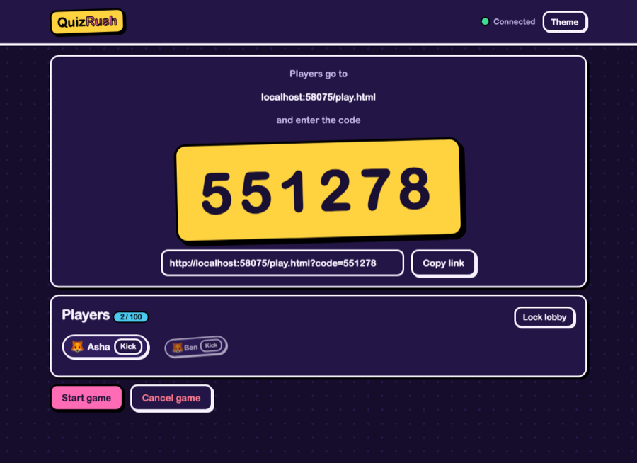
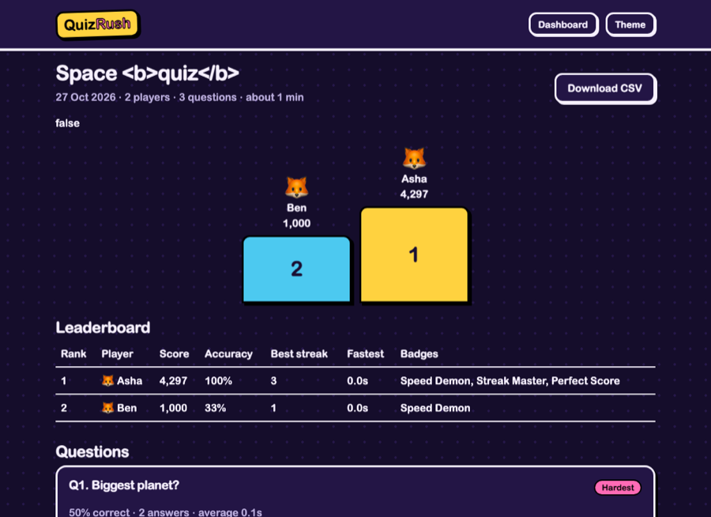
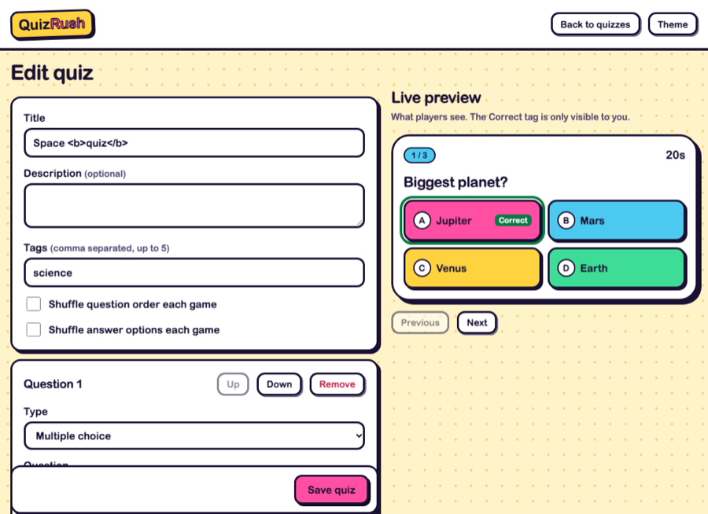
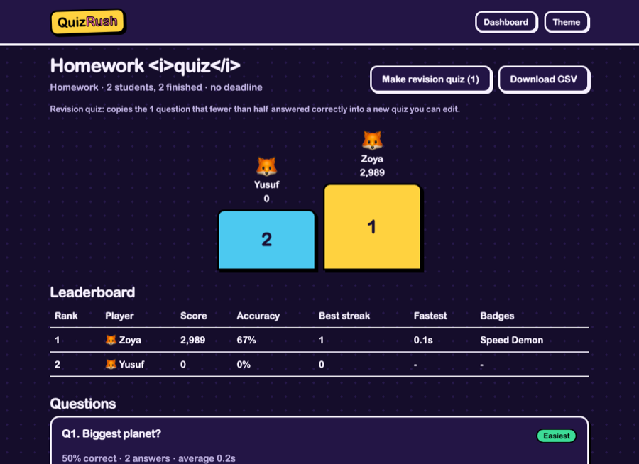

# QuizRush

> A real-time live quiz platform with a self-paced homework mode. Hosts run live games, players join from any device with a code, and the server keeps everything fair.



## Project Name

**QuizRush**: a Kahoot-style live quiz platform for classrooms, clubs and events, plus a homework mode for practice on your own time.

## Problem Statement

Live-quiz tools are usually paywalled or capped at a small number of players. The simple home-made versions are easy to break or cheat: late answers still count, a refresh kicks you out of the game, a dropped connection stalls everyone, and anyone can fire events that only the host should control. Most also stop at the end of the live session, so students who missed it, or who need more practice, get nothing.

## Target Users

- Teachers and trainers running a quick check-in or revision session
- Student clubs and event hosts running quiz nights
- Students practising on their own with a link from their teacher
- Anyone who wants a free, self-hostable alternative they can read and change

## Solution

A host builds quizzes in a library and either runs them **live** or shares them as **homework**.

**Live:** the host starts a session and gets a 6-digit code. Players join from their own devices with a nickname and an avatar, no account needed. Questions are pushed live, answers are scored on correctness, speed and streaks, and the leaderboard updates after every question.

**Homework:** the host shares a link. Students work through the quiz at their own pace, still against a server-side timer per question, and the host gets the same results page as a live game.

In both modes the server owns the clock, the scoring and the state, so the game stays fair when clients are slow, refresh or disconnect. Finished games are saved with analytics for the host and a personal summary for each player. A **revision quiz** can be created in one click from the questions most people got wrong.

| Player screen | Results page |
|---|---|
|  |  |

| Quiz editor | Homework results |
|---|---|
|  |  |

## Key Features

**Host**
- Account with register, login and logout (JWT in an httpOnly cookie, bcrypt passwords, password rules enforced on the server)
- Quiz library: search by title or tag, duplicate, delete with confirmation, import and export as JSON
- Editor with live preview, reorder, per-question time limit (5-60s) and points mode (standard, double, none), multiple choice and true/false, optional shuffling of questions and options, unsaved-changes warning
- Live controls: start, pause, resume, skip to results, next, end early, kick players, lock the lobby
- Homework: share a link with an optional deadline, choose whether students see the correct answers and a class leaderboard, close, reopen or delete it
- Results for live games and homework: podium, leaderboard, per-question analytics (hardest and easiest highlighted), per-player breakdown and CSV export
- Revision quiz: one click copies the questions that fewer than half answered correctly into a new quiz, opened in the editor
- Optional AI quiz drafts from a topic (only when an API key is configured)

**Players and students**
- Live: join with a code, a 2-16 character nickname and an emoji avatar
- Mobile-first screen with a countdown that is corrected for clock differences
- Private result after every live question: correct or not, points, streak and rank
- Refresh or reconnect and get the same seat, score and streak back, in live games and in homework
- End screen with rank, score, accuracy, longest streak, fastest correct answer and badges (Speed Demon, Streak Master, Comeback Kid, Perfect Score)
- Homework students can review their answers against the correct ones when the teacher allows it

**Platform**
- Server-authoritative timing, answer deduplication, late-answer rejection
- Zod validation on every REST body and every socket payload
- Rate limits on auth and AI routes, per-socket event throttling, a player cap per game
- Strict content security policy, no inline scripts or styles, no `innerHTML` anywhere
- Light and dark theme (follows the OS, with a manual toggle), keyboard accessible, aria-live announcements, reduced-motion support

### Scoring

| Case | Points |
|---|---|
| Wrong or no answer | 0 |
| Correct | `round(base x (1 - (elapsed / timeLimit) / 2))`, so 100% of base for an instant answer down to 50% at the buzzer |
| Base | 1000 (2000 on a double-points question) |
| Streak bonus | +100 for each correct answer you were already on, capped at +500 |
| No-points question | 0, and it does not change your streak |

Elapsed time is measured by the server and clamped between 0 and the time limit.

## Tech Stack

| Area | Choice |
|---|---|
| Server | Node.js, Express, Socket.IO |
| Database | MongoDB with Mongoose |
| Auth | JWT in an httpOnly cookie, bcrypt |
| Validation | zod |
| Security | helmet (CSP), express-rate-limit, cors |
| Frontend | Plain HTML, CSS and vanilla JS (ES modules), served by the same Express server. No framework, no build step |
| AI (optional) | @anthropic-ai/sdk |
| Tests | node:test, socket.io-client, mongodb-memory-server |
| Deployment | Render and MongoDB Atlas, optional Dockerfile |

Two small additions beyond the base stack: `cookie-parser` (reads the auth cookie) and `mongodb-memory-server` (dev only, lets the tests run without a database account).

## Architecture

```
 Browser (host)            Browser (players)         Browser (students)
 host.html + host.js       play.html + play.js       homework.html + homework.js
        |   \                  /   |                        |
        |    \  Socket.IO     /    |  REST (fetch)          |  REST only
        v      v           v       v                        v
 +----------------------------------------------------------------+
 |  Express server (one process)                                  |
 |                                                                |
 |  routes/   auth, quizzes, sessions, ai,                        |   +-------------------+
 |            homework (teacher), homeworkPlay (student)          |   |  MongoDB          |
 |  sockets/  handlers + per-socket guard                         |-->|  users, quizzes,  |
 |  game/     engine (state machine, timers, scoring),            |   |  sessions,        |
 |            homework logic, in-memory store                     |   |  assignments,     |
 |                                                                |   |  attempts         |
 |  Live games: memory only, saved to MongoDB when finished       |   +-------------------+
 |  Homework: stored in MongoDB as it happens                     |
 |  services/ aiQuiz -------------------------------------------> |-->+-------------------+
 +----------------------------------------------------------------+   |  Anthropic API    |
                                                                       |  (optional)       |
                                                                       +-------------------+
```

### Project structure

```
server/
  index.js, config.js, logger.js
  models/       User, Quiz, Session, Assignment, Attempt
  routes/       auth, quizzes, sessions, ai, health, homework, homeworkPlay
  middleware/   auth, validate, rateLimits, errorHandler
  game/         engine, scoring, achievements, homework, profanity, store
  sockets/      handlers, socketGuard
  services/     aiQuiz, exportCsv, revision
  tests/
public/
  *.html        index, login, dashboard, editor, host, play, results, homework
  css/          base, components
  js/           one module per page, plus api, ui, socket and constants
                (constants.js is shared with the server)
```

### State machine (live games)

```
            host:start              timer ends, everyone answered, or host:skip
  LOBBY ----------------> QUESTION ------------------------------------------> REVEAL
    |                        ^  |                                                |
    |                        |  | host:pause / host:resume (stays in QUESTION)   |
    |                        |                                                   |
    |                        +------------------- host:next (more questions) ----+
    |                                                                            |
    +------------- host:end, or host gone > 60s, from any state ---------------> FINISHED
                                                      host:next on the last question ---^
```

Transitions go through one function that checks an allowed-moves table, and the question timer checks the question index and state before it fires, so a double-fired timer or an illegal move does nothing.

### Socket events

All payloads are validated with zod. Event names live in `public/js/constants.js`, which both the server and the browser import.

| Event | Direction | Payload | Who |
|---|---|---|---|
| `host:create` | client to server | `{ quizId }`, or `{ code }` to take back an existing game | Logged-in host |
| `host:start` `host:next` `host:pause` `host:resume` `host:skip` `host:end` | client to server | none | Host of that game only |
| `host:kick` | client to server | `{ playerId }` | Host |
| `host:lock` | client to server | `{ locked }` | Host |
| `player:join` | client to server | `{ code, nickname, avatar }` | Anyone |
| `player:rejoin` | client to server | `{ code, token }` | Player with the secret token |
| `player:answer` | client to server | `{ choice }` | Player in the game |
| `lobby:update` | server to room | players, lock state, host connected | Everyone in the game |
| `question:start` | server to room | question, options, `endsAt`, `serverNow` (no correct answer) | Everyone |
| `answer:progress` | server to host | `{ answered, total }` | Host only |
| `answer:result` | server to one player | correct, points, streak, score, rank | That player only |
| `question:reveal` | server to room | correct answer, distribution, top 10 with rank change | Everyone |
| `game:paused` `game:resumed` | server to room | remaining time, or new `endsAt` | Everyone |
| `game:finished` | server to each socket | final leaderboard, reason, personal summary (players) or `sessionId` (host) | Everyone |
| `player:kicked` | server to one player | reason | The kicked player |
| `error:message` | server to one socket | `{ message }` | The sender |

### REST API

Errors always look like `{ "error": "message" }`.

| Area | Endpoints | Access |
|---|---|---|
| Health | `GET /api/health` | Public, reports the database state |
| Auth | `POST /api/auth/register`, `login`, `logout`, `GET /api/auth/me` | Public, then cookie |
| Quizzes | `GET/POST /api/quizzes`, `GET/PUT/DELETE /api/quizzes/:id`, `POST /:id/duplicate`, `GET /:id/export`, `POST /import` | Owner only |
| Live results | `GET /api/sessions`, `GET /:id`, `GET /:id/export` (CSV), `POST /:id/revision` | Owner only |
| Homework (teacher) | `POST/GET /api/homework`, `GET/PATCH/DELETE /api/homework/:id`, `GET /:id/export`, `POST /:id/revision` | Owner only |
| Homework (student) | `GET /api/hw/:code`, `POST /:code/join`, `GET /:code/state`, `POST /:code/next`, `POST /:code/answer` | No login, attempt token header |
| AI | `GET /api/ai/status`, `POST /api/ai/generate` | Logged in, rate limited per user |

### Design Decisions

**Live state lives in memory, on purpose.** A running game is a plain object in a `Map` with timers attached. That keeps answer handling fast and the code short, and a game only lives for a few minutes. The tradeoff: a server restart or redeploy loses every active game, and the app cannot run on several instances without sticky routing or a shared adapter. Only finished games are written to MongoDB. Games that finished or sat idle for 30 minutes are swept from memory.

**The server owns the clock.** Each question has a start time and an `endsAt` on the server. The client never reports how long it took, it only sends its choice, and the server measures elapsed time. Answers are accepted until `endsAt` plus a 300 ms grace for network lag, then rejected. `correctIndex` is never part of the `question:start` payload, it only goes out at reveal.

**Clock-skew correction.** `question:start` carries `endsAt` and `serverNow`. The client works out `offset = serverNow - Date.now()` once and draws the countdown from `endsAt - (Date.now() + offset)`, so a device with a wrong clock still shows the right remaining time. Pausing stores the remaining time, and resuming shifts both the start and the end forward by the paused duration, so paused time never counts against a player.

**Reconnect strategy.** On join the server gives each player a secret random token. The browser keeps `{ code, token }` in localStorage and sends `player:rejoin` after any refresh or reconnect. The server swaps in the new socket and replies with a snapshot (state, current question, the player's own answer and score), so the screen can be redrawn from one object. The token is never sent to other players, the lobby list uses separate public ids. Disconnected players are marked away and do not block the "everyone answered" check. Each saved seat is held by one tab at a time (Web Locks), so two tabs in one browser can be two different players. The host reconnects the same way: `host:create` with the game code takes control back, and if the host stays away for 60 seconds the game ends and players are told.

**Per-socket throttling.** `socketGuard.js` drops events from a socket that sends more than 20 a second, with tighter limits on join, rejoin, create and answer, and disconnects a socket that keeps going. Without it one client could spam answers or brute-force join codes.

**Host identity comes from the cookie, not the client.** The socket handshake reads the login cookie and verifies the JWT. A host event is only accepted from the socket that created or reclaimed that game, and whose user id matches the game's owner. There is no "isHost" flag a client could send.

**Homework is plain REST, not sockets.** A live game needs everyone in the same moment, homework does not, so it is stateless HTTP stored in MongoDB, and the live-game code is not involved. The server still owns the clock: a question's text is only sent when the student presses the button, the server records the start time, the deadline for that question is start plus its time limit plus the 300 ms grace, and a refresh shows the same question on the same timer. A question nobody answered in time is recorded as unanswered the next time the student asks for anything. Students have no account, so joining returns a secret token that identifies the attempt (only its hash is stored). There is one attempt per nickname per homework. Questions are copied into the assignment, so editing the quiz later changes nothing, and each student can get their own shuffled order. Saving an answer uses a conditional update, so a double click or two tabs cannot score a question twice. Homework requests are rate limited per attempt token, not per IP, because a whole class often shares one school IP.

**Revision quizzes come from the saved results.** A question is weak when it had answers and fewer than half were right. The new quiz is validated with the same schema as any quiz and opens in the editor so the teacher can adjust it.

**Quiz data is snapshotted.** A saved game copies the quiz title, the question text, the options and the correct answer, and a homework copies the whole question set. Editing or deleting the quiz later does not change past results.

**Safe rendering.** Everything users type (nicknames, quiz text, AI output) goes through `textContent` or safe DOM creation. The content security policy only allows the app's own scripts and styles, so even a missed escape could not run injected code. Spreadsheet exports neutralise cells that start with `=`, `+`, `-` or `@`.

## Local Setup

Requires Node.js 22.9 or newer and a MongoDB database (a free Atlas cluster, or a local `mongod`).

```bash
npm install
cp .env.example .env     # then fill in MONGO_URI and JWT_SECRET
npm run dev              # http://localhost:3000
```

Generate a secret with `openssl rand -hex 32`. If the password in your Mongo URI has special characters (`@ : / #`), URL-encode them, or use a password with only letters and numbers.

To try a player from a phone on the same wifi, open `http://<your-computer-ip>:3000` on the phone.

## Environment Variables

| Variable | Required | Description |
|---|---|---|
| `MONGO_URI` | yes | MongoDB connection string. The server refuses to start without it |
| `JWT_SECRET` | yes | Secret used to sign login tokens. Use a long random value. The server refuses to start without it |
| `PORT` | no | Port to listen on. Defaults to 3000. Hosting platforms usually set it for you |
| `CLIENT_URL` | no | Allowed origin for CORS and Socket.IO. Set it to the public URL of the app. Defaults to `http://localhost:3000` |
| `NODE_ENV` | no | Set to `production` when deployed. Turns on secure cookies, proxy trust and hides error details |
| `ANTHROPIC_API_KEY` | no | Turns on AI quiz drafts. Without it the app works fully and the AI panel is hidden |
| `AI_MODEL` | no | Model used for AI drafts. Defaults to `claude-sonnet-5-5` |
| `MAX_PLAYERS` | no | Player cap per live game. Defaults to 100 |

## Testing

```bash
npm test
```

Runs 70 tests with `node:test`. The integration tests start the real server on a random port against an in-memory MongoDB (`mongodb-memory-server`, which downloads a MongoDB binary once on the first run), so no database account is needed.

- **scoring**: instant, last-second, over the limit, wrong, double points, streak bonus and cap
- **engine**: duplicate and late answers, answers outside a question, ordering and ties, pause and resume timing, skip, completion, kick, lock, shuffling, sweeping idle games
- **validation**: the quiz schema accepts valid input and rejects bad option counts, `correctIndex` and time limits
- **achievements**: every rule
- **csv**: header, per-question points, formula and quote escaping
- **homework**: question order and shuffling, scoring and streaks, timeouts and the grace window, ranking and result shapes, plus an HTTP flow with a teacher and several students (refresh keeps the timer, one attempt per nickname, hidden answers and leaderboard, deadlines, closing, ownership, deleting)
- **revision**: the weak-question rule and the generated quiz, from both a live game and a homework
- **integration**: a host and three socket.io players play a full 3-question game and the final leaderboard and saved session are checked. Also covers refresh and rejoin, spoofed host events, kick, lock, pause, skip, host disconnect inside and outside the grace period, throttling, and the AI routes without a key

The host grace period can be shortened with `HOST_GRACE_MS` so the disconnect test runs quickly. Do not set it in production.

## Deployment

Live URL: https://quizrushh.onrender.com

QuizRush needs two things: a MongoDB database (MongoDB Atlas, free tier) and a place to run the Node server (Render, free tier). The full walkthrough:

**1. MongoDB Atlas**
1. Create an account at mongodb.com/atlas and create a free **M0** cluster.
2. **Database Access**: add a database user with a password made of letters and numbers, with read and write access.
3. **Network Access**: add the IP address `0.0.0.0/0` (allow access from anywhere). Render does not use a fixed address on the free plan.
4. **Connect**, then **Drivers**: copy the connection string and replace `<password>` with the real password. Add the database name before the `?`, like `...mongodb.net/quizrush?retryWrites=true&w=majority`.

**2. GitHub**
1. Create an empty repository on GitHub, then push this project to it. Make sure `.env` and `node_modules` are not committed (the `.gitignore` already excludes them).

**3. Render**
1. Create a **Web Service** from the GitHub repository.
2. Runtime: **Node**. Build command: `npm ci --omit=dev`. Start command: `npm start`. Health check path: `/api/health`.
3. Environment variables: `MONGO_URI`, `JWT_SECRET`, `NODE_ENV=production`, `NODE_VERSION=22`. Add `ANTHROPIC_API_KEY` only if you want AI drafts.
4. After the first deploy, copy the service URL, set it as `CLIENT_URL`, and let Render redeploy.
5. Open `<your-url>/api/health`. It should show `"db":"connected"`.

**Docker (optional)**

```bash
docker build -t quizrush .
docker run -p 3000:3000 --env-file .env quizrush
```

WebSockets work on Render without extra settings. The server trusts one proxy hop in production so rate limits see real client addresses.

| Problem | Likely cause |
|---|---|
| Logs say `Missing required env vars` | `MONGO_URI` or `JWT_SECRET` is not set on the service, or is misspelled |
| `Failed to start: Invalid connection string` | The password has special characters or `<` `>` left in. Use a letters-and-numbers password |
| `bad auth` or `Authentication failed` | Wrong database user or password in `MONGO_URI` |
| Timeout or `Could not connect to any servers` | Atlas Network Access does not allow `0.0.0.0/0` |
| Can log in locally but not when deployed | `NODE_ENV=production` needs the site to be opened over `https://`. Use the Render URL, not `http://` |
| First load is slow | Free services can go to sleep when nobody uses them. Open the site a minute before a class |

## Known Limitations

- Live games are in memory. A restart or redeploy ends all running games, and the app is meant to run as a single instance.
- Players can only join a live game while it is in the lobby. Late joining is not supported. (Homework has no such limit.)
- Homework allows one attempt per nickname and has no retakes. Students are anonymous, so a teacher who needs to know who is who should ask for recognisable names.
- On a shared computer the saved homework attempt belongs to that browser. A "Not you?" button lets the next student start fresh.
- A student who leaves homework half way stays "in progress" in the results. Nothing finishes it for them after the deadline.
- No QR code in the lobby, players use the code or the copy-link button.
- No email verification or password reset for host accounts.
- Skip means "stop waiting and show results now", answers already given still count.
- On free hosting the service can sleep after a period of inactivity, so the first request after a quiet period is slow.
- The Web Locks seat protection needs a secure context (https or localhost). Over plain http on a phone, two tabs in one browser can still take over each other's seat.
- The websocket does not check the request origin, it relies on the SameSite cookie, so that phones on a local network can connect during testing.
- AI drafts can contain wrong facts, and the editor tells the host to check every answer. The AI path was only tested without a key, and nothing is saved until the host saves it.

## Future Work

- Retakes for homework, and a best-of-attempts score
- Sending a homework link by email or to a class list
- AI quiz drafts from pasted notes or a PDF, not just a topic
- QR code for the join link
- Late joining and team mode
- Image questions and timed bonus rounds
- A shared adapter for Socket.IO and game state so the app can run on several instances
- Password reset and email verification
- Question bank sharing between hosts

## AI Usage

AI tools were used for assistance while building this project. All code was reviewed and tested by me.
